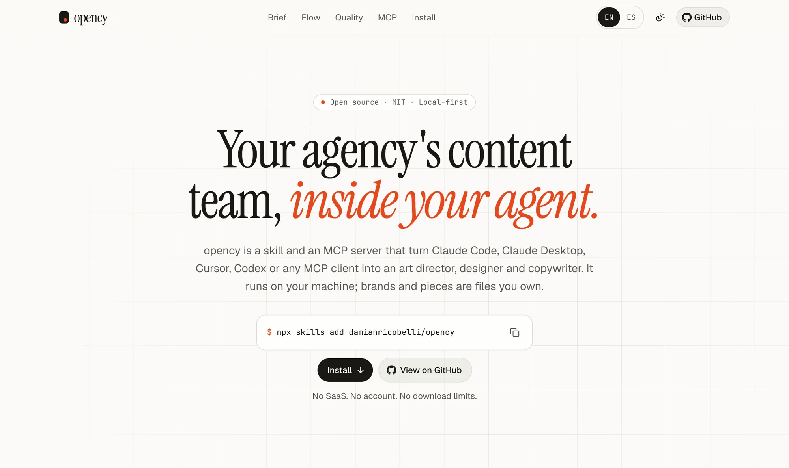
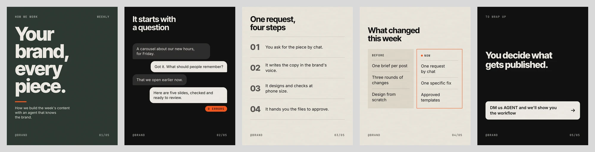
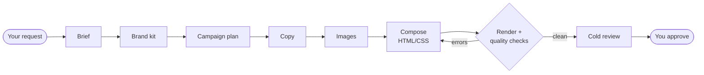
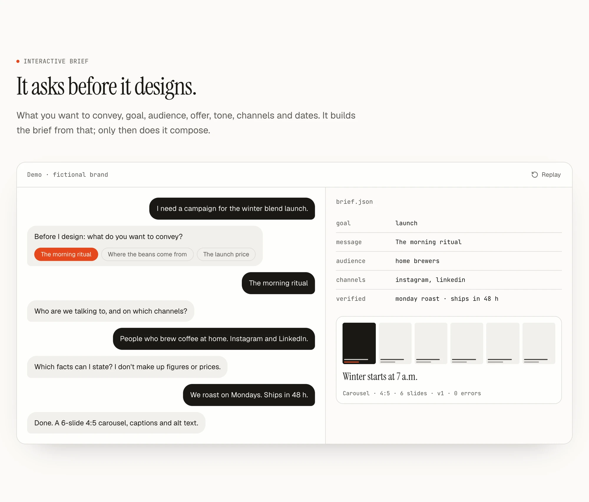
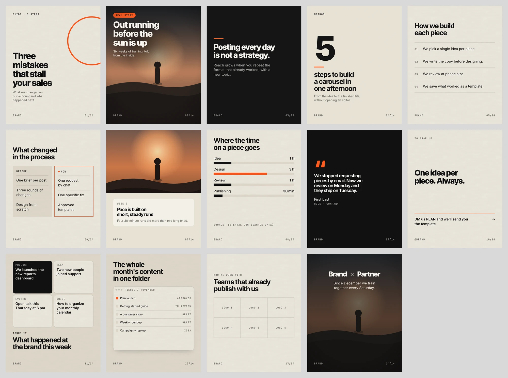
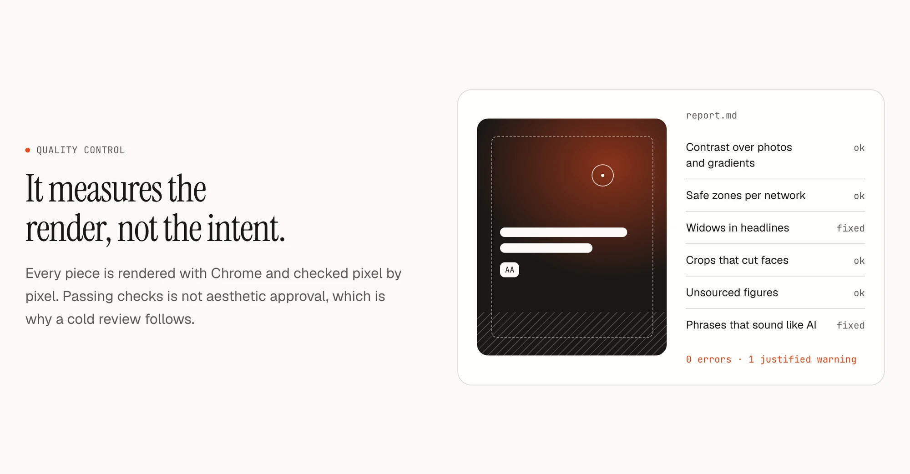

<p align="center">
  <picture>
    <source media="(prefers-color-scheme: dark)" srcset=".github/assets/hero-dark.webp">
    
  </picture>
</p>

<h1 align="center">opency</h1>

<p align="center">
  <strong>Your agency's content team, inside your agent.</strong><br>
  An open-source skill and MCP server that turn Claude Code, Claude Desktop, Cursor, Codex or any MCP client<br>
  into account manager, art director, designer and copywriter.
</p>

<p align="center">
  <a href="LICENSE"></a>
  
  
  
  
</p>

<p align="center">
  <a href="#install">Install</a> ·
  <a href="#how-it-works">How it works</a> ·
  <a href="#what-the-render-checks">Quality control</a> ·
  <a href="#mcp-tools">MCP tools</a> ·
  <a href="#commands">Commands</a>
</p>

---

It asks what you want to say before it designs. It builds the campaign with your brand's identity. It finds photos on Openverse and Unsplash. It renders every piece and checks it at the pixel level. **You approve what ships.**

Everything runs on your machine and everything is a file you own: HTML/CSS per slide, PNG/JPG/PDF/MP4 ready to upload. No account, no download limits, no SaaS.

<p align="center">
  
  <br><sub>A carousel straight out of <code>npx @opency/cli render</code>: five slides, one material, zero errors.</sub>
</p>

## Why opency

| | |
|---|---|
| **It asks first** | A short, interactive brief before any campaign: what you want to get across, to whom, where and by when. It never asks what it can read from your brand or your website. |
| **It stays on brand** | Colors, typefaces, logo and voice are read from your site and stored as tokens. Every piece is built from them, never from scratch. |
| **It checks its own work** | Contrast, safe zones, widows, cropped faces and unsourced figures are measured on the actual render, then a fresh subagent reviews the result cold. |
| **It is yours** | Open source, local-first, plain files in a folder. Several brands per workspace, ready for agencies from day one. |

## Install

Requires Node 20.9+ and Chrome (or the Chromium that `setup` downloads). For video, ffmpeg.

**See it first** — renders a demo carousel on your machine, nothing to configure:

```bash
npx @opency/cli demo
```

**1. The MCP server** — the tools your agent uses. In Claude Code:

```bash
claude mcp add opency -- npx -y @opency/cli mcp
```

<details>
<summary>Claude Desktop, Cursor and any other MCP client</summary>

```json
{
  "mcpServers": {
    "opency": {
      "command": "npx",
      "args": ["-y", "@opency/cli", "mcp"]
    }
  }
}
```

</details>

**2. The skill** — the craft: how to brief, write, compose and review.

```bash
npx skills add damianricobelli/opency
```

That is all. There is no workspace to set up: your brands and pieces live in `~/opency`, created on first use. To keep them somewhere else (a client's repo, a shared drive), run `npx @opency/cli init <folder>` there, or set `OPENCY_HOME`.

<details>
<summary>As a Claude Code plugin (skill + MCP server + reviewer subagent in one step)</summary>

```
/plugin marketplace add damianricobelli/opency
/plugin install opency@opency
```

</details>

Then ask your agent:

> Load my brand from mysite.com.<br>
> Build a campaign for the December launch.<br>
> Carousel about automating reports, 6 slides, for Thursday.<br>
> Adapt it to a story and make the video.<br>
> Propose this week's content plan.

The agent answers in your language and writes the copy in the brand's language.

## How it works



### 1. It asks before it designs

<p align="center">
  <picture>
    <source media="(prefers-color-scheme: dark)" srcset=".github/assets/brief-dark.webp">
    
  </picture>
</p>

Before a campaign or a new brand, the agent runs a brief a few questions at a time: what you want to get across, objective, audience, offer, tone, channels, dates, images. What it can infer from the brand or the website, it proposes instead of asking. Over MCP the questions arrive as a form (`brief_interview` uses MCP elicitation when the client supports it).

The one question it never skips: **what do you want to get across?** The answer becomes the thesis every piece has to prove.

### 2. It learns your brand

`npx @opency/cli brand import mysite.com` reads colors by surface, ink colors, typefaces, logo and copy from a website. The agent proposes 7 color roles, 3 font families, a voice made of hard rules and a list of verified facts, and writes them only when you say yes. Several brands can live in one workspace.

### 3. It plans, then builds

Each piece of the campaign proves the message from a different angle, and you approve the plan before anything is designed.

The agent does not write HTML. It sends each slide as data — a layout and the text for its slots — and opency builds the slide with the brand's tokens, logo and pager, renders it and returns the result in one call:

```json
{ "layout": "steps",
  "slots": { "headline": "How to brew it at home",
             "step-1": "Grind it medium-coarse.",
             "step-2": "Water just off the boil.",
             "step-3": "Four minutes, then press." } }
```

Every slot has a character budget, checked before rendering: when a text does not fit, the answer is another layout, never smaller type. There are 14 tested layouts, and raw HTML stays available for the idea no layout covers.

<p align="center">
  
</p>

Formats 4:5, 1:1, 9:16 and 16:9. Captions per network, alt text, PDF for LinkedIn and MP4 video.

### 4. It finds the right photo

Your own photos come first. Then stock: one search queries the available providers in parallel, the agent **looks at the previews**, imports only the chosen photo at full resolution and records author and license. It marks the focal point and the faces so they are never cropped or covered by text.

| Provider | Key | License |
|---|---|---|
| [Openverse](https://openverse.org) | None needed | Only CC0, public domain and CC BY (attribution is recorded) |
| [Unsplash](https://unsplash.com/developers) | Your own Access Key (free) | Unsplash License |

Openverse works out of the box. Unsplash is optional and uses **your own** account — opency ships no keys:

```bash
npx @opency/cli stock connect unsplash
```

It walks you through creating a free app in your Unsplash account, asks for the Access Key with hidden input, checks it and saves it to the workspace's git-ignored `.env`. Requests count against your own quota (50 per hour on a demo app).

### 5. It measures the render, not the intent

<p align="center">
  <picture>
    <source media="(prefers-color-scheme: dark)" srcset=".github/assets/quality-dark.webp">
    
  </picture>
</p>

Every piece is rendered with Chrome and checked pixel by pixel. Fixes that cannot change meaning or design — a headline's line breaks, the logo variant for the surface, mixed textures — are applied automatically; everything else is reported with what to do. Nothing is delivered with errors, and passing checks is not aesthetic approval — so a subagent that did not see the process reviews the contact sheet cold and returns up to 5 findings.

### 6. You decide

opency never publishes on its own. When a piece is ready:

- **Review page.** One self-contained HTML file with the slides, captions and alt text. Open it or forward it to your client: no account, no server.
- **Live preview.** A local page where you double-click any text to correct it; the agent treats your edits as approved.
- **Approval.** Recorded only when you say yes.
- **Delivery folder.** Numbered images, one caption file per network, the alt text and a checklist that flags captions over a network's limit and photo credits that are still missing.

## What the render checks

- **Pixel-level contrast**, including over photos and gradients, and logo contrast against its background.
- **Text:** headline widows, overlaps, clipping, sizes unreadable on a phone and each layout's character budget.
- **Zones:** safe area and the strip each network's UI covers.
- **Composition:** content crammed or sunk, dead space and too much accent color.
- **Consistency across slides:** a bottom bar that moves, mixed textures, the same layout repeated.
- **Photos:** upscaled beyond their resolution, crops that cut faces, text over the subject, unregistered or vetoed images.
- **Brand:** colors outside the tokens and fonts that failed to load.
- **Copy:** "AI-sounding" phrases, mixed form of address, subheads that repeat the headline, figures without a source (checked one by one), filler hashtags, generic CTAs, per-network limits and missing alt text.

<details>
<summary>What a report looks like when things go wrong</summary>

An excerpt of the real report for the deliberately broken fixture used in the test suite:

```
# Quality report — defects

4:5 · 1 slide(s) · ×1 · 7 errors · 11 warnings

## Slide 1 (flat)
- warning `outside_safe_area` #out — text outside the safe area
- warning `illegible_text_size` #tiny — 14 px on canvas = 5.1 pt on a phone (min. 10.5)
- **ERROR** `headline_orphan` #headline — last line has a single word: "sola"
- **ERROR** `critical_overlap` #a — overlaps #b
- **ERROR** `external_image` img — external image: download it into assets/ and register it
- **ERROR** `placeholder_left` — {{…}} placeholders left unfilled
- warning `over_budget` #headline — 43 characters; this layout is designed for ~20
- warning `unreadable_contrast` #low — contrast 4.18:1 (min. 4.5:1)
- warning `brand_literal_color` — colors outside tokens: #777777

## Copy and captions
- **ERROR** `unsourced_figure` slide 1 #claim — "40%": unsourced figure
- warning `copy_too_many_hashtags` caption instagram — 4 hashtags (max. 3)
- warning `copy_generic_cta` caption instagram — generic CTA: name the object (what, where, how)
- warning `missing_alt_text` slides 1 — missing alt text
```

</details>

## What you get

A workspace is a folder of plain files. Nothing is locked in a database.

```
my-agency/
├── AGENTS.md · references/          the agent's instructions
├── templates/                       base.css and the 14 layouts
└── brands/
    └── acme/
        ├── brand.json               form of address, logos, pillars, verified facts
        ├── brand-kit.md             voice, color roles, standing instructions
        ├── tokens.css               the actual colors, typefaces and scale
        ├── assets/                  logos, photos, stock, fonts + assets.json
        ├── campaigns/winter/        brief.json, brief.md and the piece plan
        └── pieces/2026-12-01-launch/
            ├── piece.json           direction, copy, captions, sources, history
            ├── slide-01.html …      one HTML file per slide
            ├── versions/            saved versions, no git required
            └── render/              slide-NN.png/jpg, contact-sheet.png, carousel.pdf,
                                     caption-*.txt, alt-text.txt, report.md
```

## MCP tools

| Group | Tools |
|---|---|
| Start | `workspace_status` · `demo` · `doctor` · `skill_guide` · `workspace_init` |
| Brand | `brand_get` · `brand_create` · `brand_use` · `brand_import_site` · `brand_fonts` · `brand_check` · `brand_write` |
| Brief | `brief_questions` · `brief_interview` |
| Campaigns | `campaign_create` · `campaign_brief` · `campaign_plan` · `campaign_status` · `campaign_list` |
| Images | `stock_status` · `stock_search` · `stock_import` · `asset_add` · `asset_analyze` · `asset_view` · `asset_list` · `asset_veto` |
| Compose | `layouts_list` · `piece_compose` · `piece_edit` · `piece_repair` · `piece_read` · `piece_list` |
| Review and delivery | `piece_preview` · `piece_handoff` · `piece_view` · `piece_render` |
| Reuse | `piece_duplicate` · `template` · `piece_version` · `piece_motion` |
| Raw HTML | `piece_create` · `piece_write` |
| Feed and results | `feed_check` · `results_add` · `results_summary` |

Also: the skill's instructions as resources (`opency://guide/…`) and three prompts (`new-campaign`, `load-brand`, `weekly-plan`).

- **One call from copy to contact sheet.** `piece_compose` takes the slides as data, builds them, renders and returns the report and the image.
- **Tools return images, not just text.** The agent sees the contact sheet and the stock previews before it decides.
- **No setup step.** The first call creates the workspace and says where; `doctor` can download the render browser.
- **One implementation.** Every tool runs the same script as the CLI, so MCP and terminal never drift apart.
- **Guardrails built in.** Approval and changes to a brand that already has pieces need the user's confirmation, slides cannot contain scripts, downloads reject private addresses, and API keys never travel through the chat.

## Commands

| Command | What it does |
|---|---|
| `npx @opency/cli demo` | Renders the demo carousel |
| `npx @opency/cli init [folder]` | Creates a workspace in a specific folder (the default is `~/opency`) |
| `npx @opency/cli setup` · `doctor` | Installs the render browser · checks the environment |
| `npx @opency/cli mcp` | MCP server (stdio) |
| `npx @opency/cli brief questions [brand\|campaign\|piece]` | The questions of each brief |
| `npx @opency/cli campaign new / brief / plan / status / list` | Campaigns |
| `npx @opency/cli brand list / use / new / import <url> / check` | Brands |
| `npx @opency/cli fonts search / add / list` | Install the brand's typefaces by name |
| `npx @opency/cli compose layouts / new / edit / slots` | Build and edit pieces from data |
| `npx @opency/cli repair <piece>` | Apply the safe fixes from the last render |
| `npx @opency/cli handoff review / status / package <piece>` | Review page, approval, delivery folder |
| `npx @opency/cli template save / list` | Brand templates |
| `npx @opency/cli new <slug> --layouts cover-type,steps,closer` | New piece with sample copy (`--campaign`, `--from`, `--format`, `--language`, `--template`) |
| `npx @opency/cli render <piece>` | PNG, JPG, contact sheet, captions and report (`--pdf`, `--scale 2`) |
| `npx @opency/cli dev <piece>` | Live preview with editable text |
| `npx @opency/cli version <piece> save / list / diff / restore` | Versions, without relying on git |
| `npx @opency/cli motion <piece> --slides all --audio track.mp3` | MP4 video |
| `npx @opency/cli assets add / stock / stock-import / analyze / veto / list` | Images |
| `npx @opency/cli stock status / connect unsplash / disconnect unsplash` | Stock providers |
| `npx @opency/cli feed` · `results` | Feed rhythm · what performed best |

All of them accept `--brand <slug>`. The workspace is the nearest folder that contains `brands/`, else `OPENCY_HOME`, else `~/opency`.

## Known limits

- **Publishing:** opency does not publish to social networks. It leaves everything ready in `render/`, or uses the publishing MCP you connect (Buffer, Metricool, Postiz…), with your confirmation on every send.
- **Image generation:** no model is included. It works with your photos, stock providers and typography.
- **Unsplash:** implemented against its API, but the automated tests only cover Openverse (no key required).
- **Photos with people:** the face-crop check depends on the agent marking the regions correctly.
- **Video:** no automatic subtitles or voice-over.
- **Copy linter:** the cliché phrase lists cover English and Spanish. Other languages get the structural checks only (figures without a source, limits, alt text, repeated subheads).
- **Typefaces:** installed by name only when they are open-licensed (Fontsource). A commercial typeface needs its files from you.
- **Review page:** a file you send, not a hosted link with comments.

## Development

```bash
git clone https://github.com/damianricobelli/opency
cd opency
pnpm install
pnpm test                          # engine + MCP server
OPENCY_TEST_NETWORK=1 pnpm test   # adds the live stock test
```

| Path | What it is |
|---|---|
| `scripts/` | The engine: each file is a command |
| `mcp/server.mjs` | The MCP server |
| `skills/opency/` | `SKILL.md` and its references: what the agent reads |
| `templates/` | `base.css` and the layouts |
| `web/` | The landing page (TanStack Start) |

Contributions are welcome: see [CONTRIBUTING.md](CONTRIBUTING.md) and [AGENTS.md](AGENTS.md).

## License

[MIT](LICENSE). The fonts bundled with the demo brand are under the SIL Open Font License.
